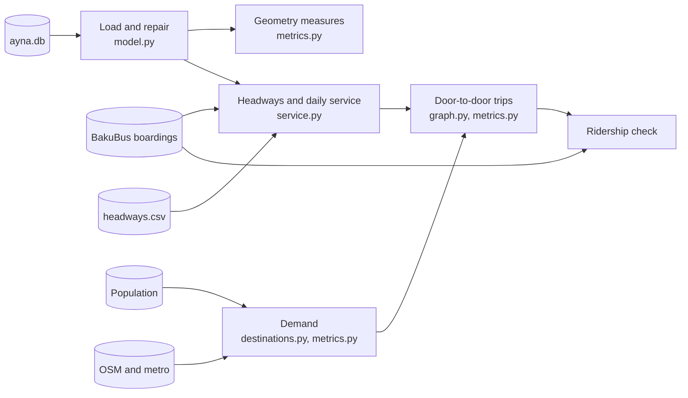

# Methodology

How every number in `output/` is made. Module names refer to files in `busnet/`.
Settings in `code` font are in `busnet.toml` ([configuration.md](configuration.md)).

## 1. Loading and repairing the network

`model.py` reads `ayna.db` into routes, stops and patterns. A pattern is one direction of
one route: its ordered stops, the path between them, and the distance along that path at
each stop (its chainage).

Repairs, applied in this order (each is logged to `output/repairs.txt`):

1. **Repeated stop lists.** A direction whose stop list is the same list twice back to
   back keeps one copy.
2. **Unusable coordinates.** A shape whose latitude equals its longitude on every point is
   dropped. A shape whose median point lies more than 50 km from the median of the route's
   stops is tried with latitude and longitude swapped; if that brings it within 50 km it is
   swapped back, otherwise it is dropped.
3. **Matching stops to shapes** (`geo.match_stops`). Every stop is projected onto every
   segment of the shape. For each stop, the candidates are the closest point of each run of
   segments within 150 m of the stop's nearest distance. A dynamic program then chooses one
   candidate per stop so that the distance along the shape never goes back by more than
   30 m from one stop to the next, with the smallest total offset. A stop with no in-order
   candidate is an **order break**. A shape's fit is (order breaks, median offset).
4. **Which shape belongs to which direction.** Each direction is scored against each
   stored shape and its reverse, and the better of the two is kept. Today's assignment is
   replaced by the alternative (swapped directions, or a lone shape moved to the other
   direction) only on clear evidence: at least max(2, 20% of the route's stops) fewer order
   breaks, or no more breaks and a total median offset below 70% of the current one. A
   shape that fits better reversed is reversed.
5. **Quality gate.** A shape is dropped, and its direction drawn as straight lines between
   stops, if it has more than max(2, 10% of its stops) order breaks, a median offset over
   60 m, or any straight segment longer than 5 km.
6. **Chainage.** The distance along the shape at each stop, starting at zero at the first
   stop. Each hop is at least the straight-line distance between its two stops, which also
   absorbs the occasional stop matched slightly out of order. The stored path runs from the
   first stop to the last.

## 2. Geometry measures

All distances are great-circle (haversine). Grids and buffers use a flat projection
centred on Baku, accurate to better than 1% across the area.

| Measure | Definition |
|---|---|
| One-way length | Chainage of the last stop, averaged over the route's directions |
| Stop gap | Distance along the path between consecutive stops |
| End-to-end circuity | Path length ÷ straight line between the first and last stop (not defined when they are less than 1 km apart) |
| Shape class | Direct up to 1.4; indirect 1.4 to 2; very indirect 2 to 3; loop over 3 or ends less than 1 km apart. A route takes its less direct direction |
| Excess over shortest path | Path length ÷ shortest path between the same two stops, minus 1. The shortest path runs on a graph of every stop-to-stop link some route drives (both ways), plus links between stops less than 80 m apart |
| Rider circuity | For every pair of stops on the direction at least 1 km apart: distance along the route ÷ straight line; averaged |
| Detour | A stretch from stop i to stop j (at most 12 stops and 40% of the route) whose path is at least 2.5 times the straight line and at least 1.5 km longer than it. Overlapping detours keep the largest |
| Extra minutes of a detour | Extra distance ÷ moving speed + stops inside × `stop_loss_s` |
| Shared share | Share of a direction's length on links that at least one other route also uses (heavy: at least five routes) |
| Duplication ratio | Total route-km of all directions ÷ km of distinct directed stop-to-stop links |
| Trunk corridor | A run of consecutive links on which at least 8 routes share every link, at least 1 km long. When it starts and ends within 1 km (out and back), the stop farthest from the start is named as the turn |
| Near-duplicate | A route (at least 10 stops) with at least 85% of its stops also served by one other route; express routes are left out |

## 3. Running time, fuel and CO₂ per trip

For one trip in one direction (`service.py`):

- running time = length ÷ `cruise_kmh` for the route's zone + (stops − 1) × `stop_loss_s`
- fuel = length in km × `fuel_l_per_km` + (stops − 1) × `fuel_l_per_stop`
- CO₂ = fuel × `co2_kg_per_l`

With the defaults, total route-km divided by total running time over all directions is
22 km/h, the bus speed AYNA reported in November 2024.

## 4. Headways and daily service

Each route's headway is the first of (`service.route_headways`):

1. **supplied**: a row in `data/headways.csv`;
2. **ridership**, when `headway_from_ridership` is on and the route has observed boardings:
   trips per direction = weekday boardings ÷ 2 ÷ `boardings_per_trip`, and
   headway = `service_hours` × 60 ÷ trips, kept between `min_headway_min` and `max_headway_min`;
3. **zone**: `headway_by_zone` for the route's working zone;
4. **default**: `default_headway_min`.

Today: 1 supplied (H1), 55 from ridership, 145 by zone. Daily service per route
(`service.operations`), with both directions:

- trips a day = 2 × `service_hours` × 60 ÷ headway
- bus-hours a day = trips a day ÷ 2 × round-trip running time
- bus-km a day and fuel a day follow the same way from length and fuel per trip
- buses needed = round-trip running time × (1 + `layover_share`) ÷ headway, rounded up per route

The network totals are compared with `reference_fleet`: 2,015 buses, 88% of 2,300.

## 5. Population and coverage

`population.py` reads the Kontur hexagons in the box around the served stops plus 2 km.
Each hexagon becomes seven points that share its population: its centre and six points
at a third of the hexagon's width around it, the way H3 divides a cell into seven.

- **Coverage**: people at points with a served stop within `coverage_radius_m`.
- **Area within the radius**: 100 m grid cells whose centre is within the radius of a stop.
- **People only one route serves**: people whose only routes within the radius are that one.

The straight line is a proxy for the walk, and rail lines, motorways and the bay make
it too short. As a check, `walking.py` measures the same walk along the streets and
paths in OpenStreetMap (`walk_network` in the settings): every way tagged `highway` in
the study area, keeping those a pedestrian may use. Following OSMnx's walk network, it
drops motorways and their links, busways, raceways, platforms, cycleways without a
`foot` permission and ways planned, under construction or gone, and any way tagged
`foot=no`, `service=private`, or `access=no` or `access=private` without a `foot`
permission. The ways become an undirected graph whose segments have great-circle
lengths. Each served stop and each population point joins the graph at the nearest
point of the nearest segment, walking that gap in a straight line, and one Dijkstra run
from all the stops at once gives the walk from every point to its nearest stop, up to
2 km. `robustness.py` reports, for each radius, the people within it in a straight line
and along the network, and how far the walk exceeds the line (section 10). The straight
line stays the measure in every other result, so the two can be compared.

## 6. Demand

No origin-destination data is public, so trips are spread with a gravity model:

- Trips start at homes. Origins are sampled in proportion to population (300 origins,
  seed 7, for the measures).
- From each origin, trips end at every zone in proportion to its pull × exp(−distance ÷
  `trip_decay_km`), and each origin's trips add up to one.
- A zone's pull = (1 − `destination_share`) × its population + `destination_share` × total
  population × its share of all destination weight (`destinations.zone_attraction`).
- Destination weight comes from OpenStreetMap features (`destination_weights` by kind)
  and metro exits (`metro_weight_per_1000_entries` per 1,000 weekday entries at the
  station, split across its exits). Each feature is credited to its nearest zone within 1.5 km.

## 7. Door-to-door trips

`graph.TransitGraph` holds, for every served stop, an arrival node and a departure node,
and for every route direction a chain of on-board nodes:

| Link | Cost |
|---|---|
| Departure at a stop → board a route | half the route's headway + `transfer_penalty_min` |
| On board → next stop of the same route | hop distance ÷ moving speed + `stop_loss_s` |
| On board → get off (arrival node) | 0 |
| Arrival → departure at the same stop | 0 |
| Arrival → departure at another stop within `max_transfer_walk_m` | walking time |

Walking time = straight-line distance × `walk_detour` ÷ `walk_speed_mps`. Walking happens
once between rides, never chained.

A trip walks from its origin point to any stop within `max_access_walk_m`, follows the
cheapest path (Dijkstra's algorithm, up to `max_trip_min`), and walks from a stop within
`max_access_walk_m` to its destination. Every boarding pays the transfer penalty, so one
penalty is taken off at the end: the first boarding is not a change. Trips under 2 km may
also be walked entirely, whichever is quicker.

Reported (`accessibility` in `output/network.json`): the mean door-to-door time of trips
possible within `max_trip_min`; the share of trips possible within 30, 45 and 60 minutes
and within the limit; the share of trips whose origin or destination has no stop within
reach; the average straight-line trip length; and the number of changes on bus trips.

## 8. Ridership check

Each modelled trip is followed back along its path and every boarding it makes is
counted on that route. Both modelled and observed boardings are turned into shares of
their own total over the 56 BakuBus routes in both, and compared with Spearman's rank
correlation (1 means the same ranking) and the correlation of the logarithms of the shares.

| Model inputs | Correlation |
|---|---|
| One headway of 12 minutes for every route, trips to homes only | 0.41 |
| Headways by service type, trips to homes only | 0.56 |
| Plus destinations (OpenStreetMap, metro) | 0.58 |
| Plus headways estimated from boardings | 0.77 |

The last step uses the same boardings it is checked against, so 0.58 is the fair
measure of how well the model predicts (`python3 measure.py --set headway_from_ridership=false`).
In that run the model overrates express routes such as E1, 120E and 72, and underrates
several suburban routes such as 139, 141E, 189 and 163. `output/robustness/fit_ladder.csv`
holds the four steps (section 10).

## 9. Stop balancing

`scenarios.balance_stops` removes a stop only when, on every route direction that uses it,
it is not a terminal, a flagged hub or a protected stop; it lies less than `--min-gap`
metres along the path from its previous or next kept stop; and removing it leaves no gap
longer than `--max-gap` (700 m). Stops served by fewer routes are considered first, so busy
transfer stops survive. In the redesign, a stop that would leave anyone without a stop
within `max_access_walk_m` is protected and the pass runs again.

## 10. Robustness checks

`robustness.py` repeats the main results under other conditions and writes
`output/robustness/` ([outputs.md](outputs.md)).

- **Fit ladder.** The ridership check of section 8, four times, adding one input at a
  time: every route every 12 minutes with trips to homes only; headways by service type;
  plus destinations; plus headways from boardings (the default). Each step runs
  `evaluate_od` on the same 300 origins as `measure.py` and compares the modelled
  boardings with the observed ones. H1 keeps its published headway from step 2 on.
- **Coverage by radius.** The coverage of section 5 at 300, 400, 500, 800 and 1,000 m.
- **Coverage by walking distance.** The same five radii with the distance walked along
  OpenStreetMap's streets and paths (section 5) beside the straight line, the people the
  straight line counts whose walk is longer, and the ratio of walk to line for everyone
  within 1,000 m of a stop: its population-weighted median, third quartile and 90th
  percentile, and the share over `walk_detour`. Skipped when the settings name no
  `walk_network` file.
- **Other trip samples.** The redesign search runs exactly as in `redesign.py`, then
  today's network and the redesigned one are scored with `evaluate_od` on ten different
  samples of 300 origins (seeds 1 to 10, the seven-point population, the gravity model
  with destinations). Each row gives the average door-to-door minutes counting a trip
  that cannot be made within 2 hours as 120, as the search does, and the gain. Seed 7 is
  the independent check that `redesign.py` reports.
- **Other assumptions.** `redesign.py` runs again, in parallel processes, under fourteen
  changed settings (transfer penalty 2 and 8 minutes; distance decay 4 and 9 km; homes
  only; 45 and 80 boardings per trip; 400 m walks; a search sample of 200 origins and
  one with another seed; nobody may lose a stop; no bus shifts; the service-type headway
  table times 0.8 and times 1.25), plus the committed settings. Each row
  reports what the search kept, its independent check and its fleet-saving option, from
  that run's `summary.json` and `changes.csv`.

## 11. How far to trust the numbers

- **Measured from the data**: lengths, stop spacing, directness, duplication, corridors,
  near-duplicates, detours (except their minutes), coverage.
- **Estimated with assumptions**: running times, fuel, CO₂, headways, daily service,
  door-to-door times, transfers, modelled boardings. They are for comparing versions of
  the network, not forecasts.
- **Checks**: average speed calibrated to the reported 22 km/h; implied fleet 2,015 against
  2,300 reported; the population grid's 3.04 million against official 3.22 million; model
  ridership ranking 0.58 against observed; the redesign's gain on ten trip samples and
  under fourteen other settings ([results.md](results.md#how-robust-the-results-are)).

## 12. The benchmark networks

`benchmark.py` with `busnet/utrp.py`; the reasons and the results are in
[benchmark.md](benchmark.md).

- **Data.** Mandl's network and Mumford0–3 from Mumford's (2013) supplement
  (`data/external/utrp/CEC2013Supp.zip`): link times in minutes (`Inf` where there is no
  link), trips between every pair of nodes, and the route sets best for passengers and
  for the operator. Beside them, the route sets two later studies published: the ends of
  the Pareto sets of Hüsselmann et al. (2024), best for the operator and for passengers,
  from their results repository, and the passengers' sets of Jiao (2026) from the
  author's archive ([data.md](data.md#route-sets-published-later-husselmann2024-jiao2026)).
  Nodes are numbered from 1 in Mumford's and Jiao's files, from 0 in Hüsselmann's, and
  from 0 in the code.
- **Scoring.** One graph node per route and node on it, with links both ways along each
  route, and one change node per network node that costs 5 minutes to reach and nothing
  to leave. Dijkstra from every origin on (minutes, changes), so that of equally quick
  paths the one with fewer changes counts. ATT = Σ trips × minutes ÷ Σ trips over all
  pairs with trips; d0, d1 and d2 are the shares of trips whose path has 0, 1 or 2 changes
  and dun the share with 3 or more; route time = the sum of link times along every route,
  one way. A route set with a trip that has no path scores nothing.
- **Rules.** Exactly the published number of routes (Mandl 6, Mumford0–3 12, 15, 56 and
  60); between 2 and 8 nodes on a route on Mandl's network, 2 and 15 on Mumford0, 10 and
  30 on Mumford1, 10 and 22 on Mumford2, 12 and 25 on Mumford3 (Mumford, 2013, Table
  II); routes follow links and visit no node twice; every node on a route; every route
  reachable from every other by changing at shared nodes.
- **Straightening.** A detour is a stretch from node i to node j of a route, at most
  max(3, min(12, 40% of the route's nodes)) apart, whose time along the route is longer
  than the quickest path between i and j along any links; of overlapping stretches only
  the one that wastes the most counts, as in `metrics.find_detours`. A change replaces
  the stretch by the quickest path. A pass tries the 80 detours that save the most route
  time, each alone, and keeps those that break no rule and lower ATT by more than 0.005
  minutes; it then applies them in order of their gain, scores each again on the routes
  as they are by then, and skips a change whose route has changed since it was found. The
  80 and the 0.005 minutes are the redesign's defaults, `redesign_max_straighten` and
  `redesign_min_gain_min`. The repeated search runs passes until one keeps nothing.

## 13. Bicycle lanes and parking

`bicycle.py` reads AYNA's two files with `busnet/bicycle.py`
([data.md](data.md#bicycle-lanes-and-parking)): the lanes as polylines named after their
streets, the parking points as MPV (bicycle parking) and MPS (unexplained) points. Every
distance is a straight line in the flat projection of `geo.py`, as elsewhere.

- **A stop near a lane**: a served stop whose nearest lane is within 50, 100 or 200 m;
  the tables use 100 m.
- **A route along a lane**: a route direction's path is sampled every 20 m, and a sample
  within 40 m of a lane counts the length it stands for towards that lane. 40 m spans a
  dual carriageway, so a lane on one side counts for a bus on the other; at 25 m the lane
  km beside a bus route fall from 47.5 to 44.8, at 60 m they rise to 49.1. A route's km
  along lanes is the mean over its directions, like its one-way length. It is listed on
  a street when it runs at least 100 m along that street's lane in either direction, and
  counted as a route along the lanes from 0.5 km.
- **A lane beside a bus route**: the same sampling along the lane, against the paths of
  every route direction, within 40 m.
- **A parking point near a stop, a lane or a metro exit**: within 100 m of the nearest
  served stop; within 50 m (the hackathon's distance) or 100 m of the nearest lane;
  within 300 m of the nearest of the 98 metro exits in `metro_exits.csv`. An MPV point
  is on an MPS point when the two are within 5 m.
- **People within reach of a lane**: the population points of section 5 within
  `coverage_radius_m` (400 m) of a lane, of a served stop, of both, and of an MPV point,
  so that the figures compare with coverage directly.

The lane lengths are great-circle lengths of the drawn lines; in the UTM zone the
hackathon asked for, EPSG:32639, they are 0.03% shorter. The thresholds are constants
at the top of `busnet/bicycle.py` rather than settings, since nothing else depends on
them; `summary.json` records them under `settings`.
