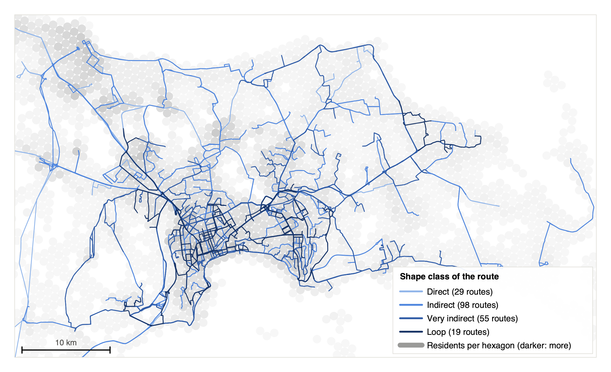
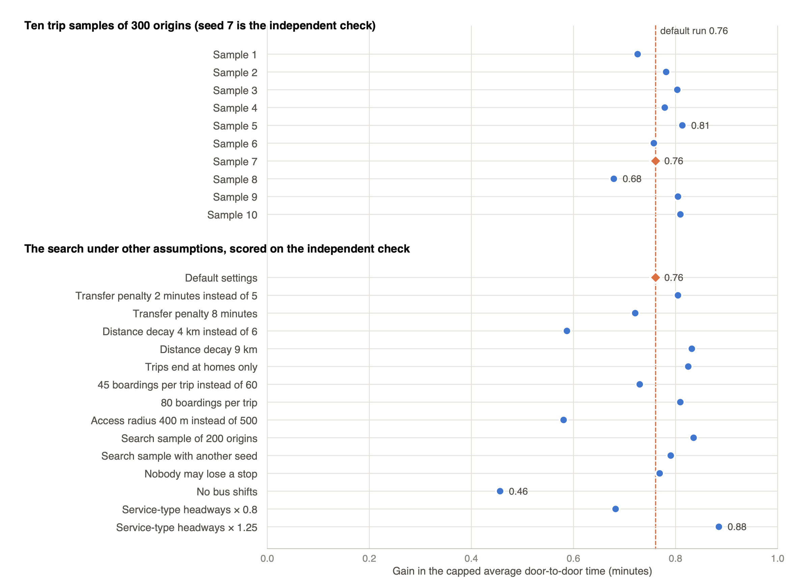

# What Baku's own open data says about its bus routes

*A measurement of 201 routes from public data alone, a travel model that admits how well it works, and a redesign that keeps every bus. Preprint and code linked at the end.*

Baku is redesigning its bus network. About 200 routes carry 1.6 million trips a day, the transport agency AYNA has been working with an international consultant on a digital twin of the city since 2023, and the first routes of the new network started running in January 2026. What the public can see of this is the agency's map of routes and stops, and a handful of figures in press releases. There is no published evaluation of the network, and the data such an evaluation would normally rest on, timetables, vehicle positions and where riders travel, is not public.

So I asked a narrower question: how much can be learned about a bus network, and how far can a redesign be tested, from public data alone? The answer matters beyond Baku, because many cities publish a map and little else.

## What I used

Five public sources: the agency's map API (routes, stops, stop sequences and route shapes), a population grid (Kontur, hexagons of about 0.74 km²), OpenStreetMap destinations (schools, hospitals, shops, offices and the like), metro entries per station, and the daily boardings per route that the state operator BakuBus publishes on the national open-data portal.

The map data needed repairing first. Its length field is the round trip, its duration field is length divided by 0.6 on every route, 13 routes have their shapes filed under the wrong direction, three shapes are stored backwards, one has latitude and longitude swapped, and seven routes have no stops at all. None of this is documented. The code detects and fixes these defects from the data itself, so the repairs survive the next download.

## 1. The routes wander

Only 29 of the 201 routes are direct, meaning their path is within 1.4 times the straight line between their ends. The median route is 1.77 times the straight line; 55 routes are over twice and 19 are loops. Buses run 7,398 km of route over 3,824 km of distinct road links, so each link carries 1.93 routes on average, and on 21 trunk corridors eight or more routes share every link.

Detours are common and mostly unnecessary. There are 271 of them, adding 939 km to one trip in each direction of every route, and for 217 of them everyone living near the stops inside the detour has another route within 400 m anyway. The longest, on route 177, covers 21 km between two stops 8 km apart and adds 27 minutes to every through trip, for 53 people whom only that route serves.

*Figure 1. Every route direction coloured by the route's shape class, from direct (light) to loop (dark), over the population grid in grey.*

## 2. Who the network reaches, and how honest the model is

Two thirds of the 3.04 million people in the area live within 400 m of a served stop; 91.5% within 1 km. A door-to-door travel model, built from the same public data with a gravity model for where people go, gives an average trip of 51.8 minutes, with 29% of trips possible within 45 minutes and 35% of trips having no stop within 500 m at one end or the other.

How much can such a model be trusted? I checked its ranking of routes against the observed boardings of the 56 BakuBus routes that have counts. The Spearman correlation is 0.58: it ranks routes moderately well, no better. The paper says so rather than hiding it, and the redesign uses real counts wherever they exist for exactly that reason.

## 3. A redesign that keeps every bus

I then ran a cautious search that applies the changes other cities' redesigns have used, merging near-duplicate routes, dropping lightly used ones, straightening detours, thinning closely spaced stops and moving buses to where they save riders the most waiting, while keeping today's fleet and never leaving more than a few hundred people without a stop. It keeps 27 changes. On trips it was not tuned to, the average trip shortens by about a minute; or, taken the other way, today's travel times can be delivered with about 12% fewer buses, bus-hours and fuel.

A minute is small, so I tested how far it depends on luck and assumptions. On 10 independent trip samples the gain is 0.68 to 0.81 minutes, and under 14 alternative assumptions, from different transfer penalties to different headways for the routes without counts, it stays between 0.46 and 0.88. The smallest gain is the run without the least certain kind of change, the bus moves: the structural changes alone keep three fifths of the gain. And a stricter rule under which nobody at all loses a stop gains as much as the default run, so the 976 people the default run strands buy nothing.

*Figure 4. The gain in average door-to-door time on ten trip samples (top) and under fourteen alternative assumptions (bottom), with the default run marked.*

## What this is not

It is not a plan and not a forecast. Headways are estimated for 200 of the 201 routes, because no timetable is published; the demand model is a gravity model; the metro is not in the travel graph; and the map describes the inherited network, not the one being launched, since on 23 October 2026 the agency's API still returned exactly the routes of May while the counts already list eight new ones. The changes the search proposes are candidates for people who know the city to review, with the strict no-one-loses-a-stop rule as the safer version.

What it is: a measured baseline. When the map carries the new network, the same three commands will score it on the same measures, which no other public source allows. Every input, every setting and every result are in the repository, and every number in the paper regenerates from it.

## Where to read more

- The paper: preprint on engrXiv (submission 8632; the DOI will appear here once it is posted) and submitted to the journal *Public Transport*.
- The code, data and results: https://github.com/ismatsamadov/route_efficiency, archived at https://doi.org/10.5281/zenodo.23604370.

*Text and figures are CC BY 4.0. The maps draw the agency's route geometry and the Kontur population grid.*
